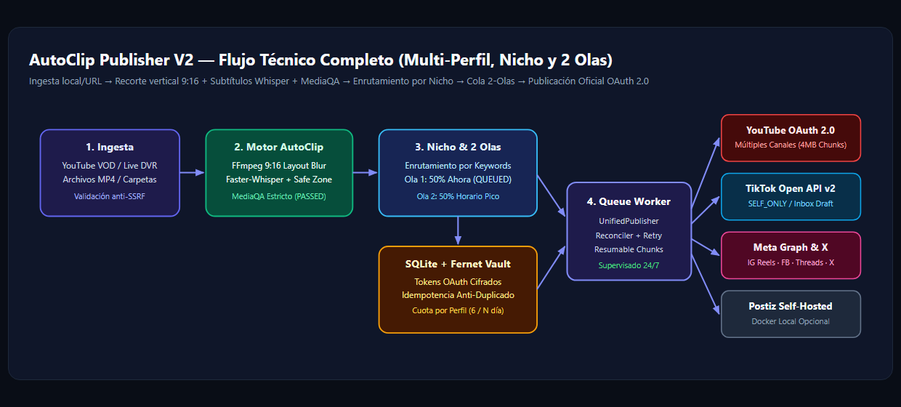
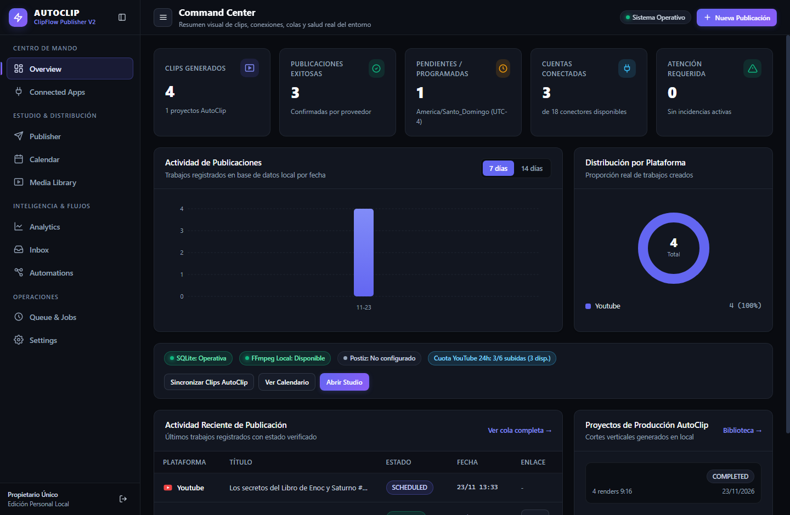
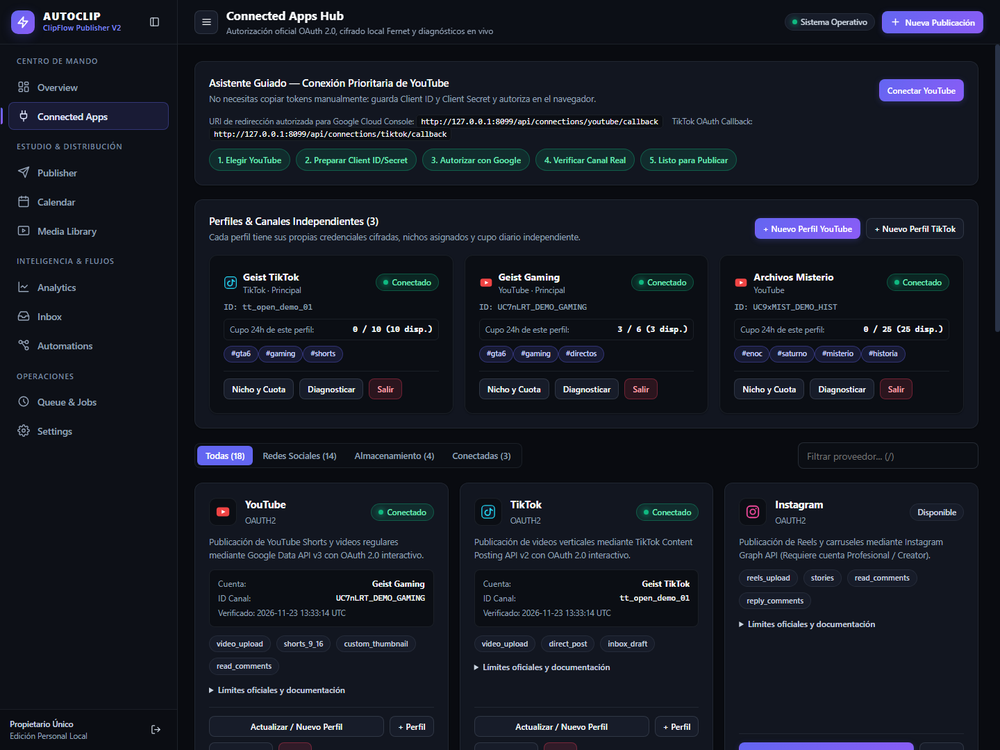
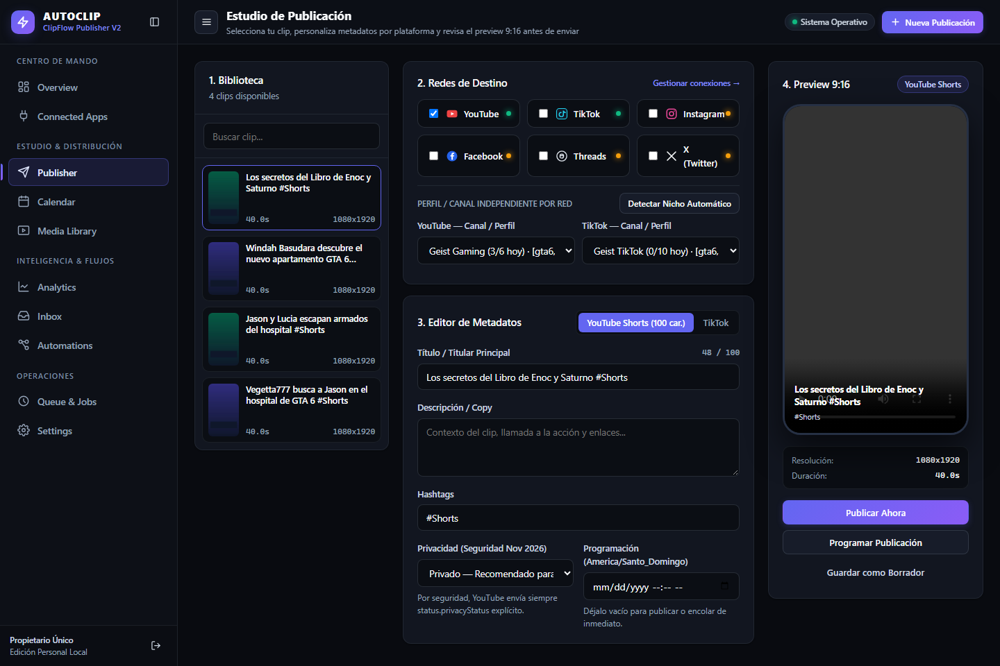
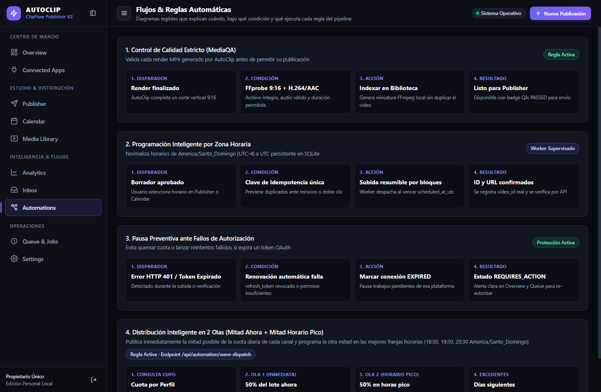

# AutoClip Publisher — Personal Edition V2

> **Plataforma privada, autohospedada y sin SaaS obligatorios para extraer clips verticales 9:16, validar su calidad audiovisual y publicarlos automáticamente en múltiples canales y redes sociales (YouTube Shorts, TikTok, Instagram, Facebook, Threads, X, LinkedIn y más) con cifrado local Fernet y control total de cuotas.**



---

## Cómo Funciona de Principio a Fin

AutoClip Publisher V2 orquesta un pipeline completo en 6 etapas, ejecutando dos procesos supervisados simultáneamente ([`clipflow.supervisor`](src/clipflow/supervisor.py)): el **Panel Web FastAPI (`127.0.0.1:8000`)** y el **Worker Persistente de Cola (`PublishQueueWorker`)**.

1. **Ingesta Segura (`IngestionService`):**
   - Acepta archivos locales (`.mp4`, `.mov`, `.mkv`, `.webm`, `.avi`), carpetas completas o enlaces HTTPS validados contra SSRF (`youtube.com`, `youtu.be`, `bilibili.com`, `b23.tv`), incluyendo captura de bloques DVR desde transmisiones en directo.
2. **Producción Vertical 9:16 y Control de Calidad (`AutoClipAdapter` + `MediaQA`):**
   - Reutiliza el motor de AutoClip (`FFmpeg` con *layout blur* `1080×1920`, transcripción local con `faster-whisper` y subtítulos quemados de alto contraste en zona segura `MarginV=340`).
   - `MediaQA` inspecciona códec (`H.264/AAC`), duración, resolución vertical y audio antes de indexar cada clip en la **Biblioteca Audiovisual** sin duplicar archivos en disco.
3. **Tarjetas Independientes Multi-Perfil (`AccountConnection` + `ConnectionService`):**
   - Puedes conectar **múltiples cuentas o canales independientes dentro de la misma plataforma** (por ejemplo, varios canales de YouTube y varias cuentas de TikTok, Instagram o Facebook).
   - Cada tarjeta conserva de forma aislada sus tokens OAuth 2.0 cifrados con **Fernet**, sus palabras clave de nicho (`niche_tags`) y su límite diario permitido (`daily_upload_limit`).
4. **Enrutamiento Automático por Nicho (`niche_router.py`):**
   - Al ingresar un enlace o texto de video, AutoClip extrae título, creador y etiquetas para detectar la temática (`gta6, gaming` vs `enoc, misterio`, etc.) y asigna automáticamente el perfil destino correspondiente en cada red.
5. **Distribución Inteligente en 2 Olas (`build_wave_schedule`):**
   - Divide cada lote según el cupo disponible del canal en ese día:
     - **Ola 1 (Inmediata — `QUEUED`):** publica de inmediato la mitad posible del cupo diario.
     - **Ola 2 (Horario Pico — `SCHEDULED`):** programa la otra mitad en las mejores franjas horarias de `America/Santo_Domingo` (`18:30`, `19:30`, `20:30`, `21:30`, `12:30`, `15:30`), enviando excedentes a días siguientes sin saturar ni evadir cuotas.
6. **Subida Resumible por Bloques y Reconciliación (`UnifiedPublisher` + `Reconciler`):**
   - **YouTube (`NativeYouTubePublisher`):** subida resumible en bloques de `4 MB` (`Content-Range` / `308 Resume Incomplete`), renovación automática de `refresh_token` y verificación remota por `videos.list`.
   - **TikTok (`NativeTikTokPublisher`):** OAuth 2.0 interactivo y Content Posting API v2 con chunks (`5–64 MB`), privacidad `SELF_ONLY` por defecto y mapeo estricto de `fallback_to_inbox` / `SEND_TO_USER_INBOX` a `ACTION_REQUIRED`.
   - **Idempotencia:** cada envío genera una clave `idempotency_key` única y consulta el estado remoto antes de reintentar ante cortes de red o reinicios.

---

## Capturas del Dashboard V2

### Command Center (`Overview`)
Métricas reales desde SQLite, gráficos interactivos SVG sin CDNs externos, estado en vivo de FFmpeg/Postiz y consumo de cuota diaria de YouTube (24h).



### Connected Apps Hub — Tarjetas Multi-Perfil, Nichos y Cuotas
Cada perfil/canal conectado aparece como una tarjeta independiente con su nicho (`#gta6`, `#misterio`), su cupo diario (`usados / límite`), OAuth interactivo para YouTube y TikTok, y diagnóstico en vivo.



### Estudio de Publicación (`Publisher Studio`)
Explorador de clips 9:16, selector explícito de canal/perfil por red, botón **Detectar Nicho Automático**, editor de metadatos (máx. 100 caracteres en YouTube Shorts) y vista previa vertical en vivo.



### Flujos & Reglas Automáticas (`Automations`)
Reglas activas visibles: control estricto `MediaQA`, normalización horaria `America/Santo_Domingo → UTC`, pausa automática ante tokens expirados (`401`) y distribución inteligente en 2 olas (`/api/automation/wave-dispatch`).



---

## Las 10 Secciones del Dashboard

| Sección | Ruta | Función Principal |
|---|---|---|
| **Overview** | `/` | KPIs reales, gráficos de actividad/plataformas, estado del motor y cuota 24h |
| **Connected Apps** | `/connections` | Gestión multi-perfil para 18 proveedores, OAuth YouTube/TikTok, nichos y cuotas |
| **Publisher Studio** | `/publisher` | Preview 9:16, selección por perfil/nicho, privacidad y envío inmediato o programado |
| **Calendar** | `/calendar` | Calendario editorial en `America/Santo_Domingo` con reprogramación |
| **Media Library** | `/media-library` | Biblioteca local, importación de carpetas e ingesta VOD por URL |
| **Analytics** | `/analytics` | Métricas reales consultadas desde YouTube Data API v3 (`SIN_DATOS` si no aplica) |
| **Inbox** | `/inbox` | Sincronización de comentarios reales de YouTube, respuesta oficial y auto-respuesta con cooldown |
| **Automations** | `/automations` | Reglas visuales del pipeline y automatización en 2 olas |
| **Queue & Jobs** | `/queue` | Monitor persistente por etapas, diagnóstico de errores y reintento idempotente |
| **Settings** | `/settings` | Salud del entorno, copias de seguridad ZIP verificadas y restauración segura |

---

## Conectores Soportados (18 Proveedores)

- **Nativos directos con OAuth 2.0 interactivo y subida por bloques:** `YouTube` (Google Data API v3), `TikTok` (Content Posting API v2).
- **Redes sociales vía API oficial / Postiz Self-Hosted:** `Instagram`, `Facebook Pages`, `Threads`, `X (Twitter)`, `LinkedIn`, `Pinterest`, `Bluesky`, `Reddit`, `Telegram`, `Discord`, `WordPress`, `Google Business`.
- **Ingesta y almacenamiento:** `Google Drive`, `OneDrive`, `Dropbox`, `Carpeta Local`.

---

## Máquina de Estados de Publicación

```
[DRAFT] ──> [READY] ──> [SCHEDULED] ──> [QUEUED] ──> [UPLOADING] ──> [PROCESSING] ──> [PUBLISHED]
                                            │             │                 │
                                            ▼             ▼                 ▼
                              [QUEUED_FOR_DAILY_QUOTA] [RETRYABLE_ERROR] [ACTION_REQUIRED / REQUIRES_ACTION]
```

- **Protección de Cuotas:** Si un perfil alcanza su `daily_upload_limit`, los trabajos de ese perfil quedan en `QUEUED_FOR_DAILY_QUOTA` sin saltar ni mezclarse con otros canales.
- **Protección de Autenticación:** Ante errores HTTP `401`, solo ese perfil pasa a `EXPIRED` y sus trabajos se pausan en `REQUIRES_ACTION`.

---

## Documentación Técnica y Despliegue en PC Dedicado 24/7

- **Guía Técnica Gráfica en PDF (TikTok OAuth, Otras Plataformas y PC 24/7):** [docs/GUIA_TECNICA_AUTOCLIP_TIKTOK_Y_PLATAFORMAS.pdf](docs/GUIA_TECNICA_AUTOCLIP_TIKTOK_Y_PLATAFORMAS.pdf)
- **Guía Rápida de Comandos para PC de Automatización 24/7:** [docs/GUIA_PC_AUTOMATIZACION_24_7.md](docs/GUIA_PC_AUTOMATIZACION_24_7.md)
- **Credenciales por Proveedor y Seguridad:** [docs/PROVIDER_CREDENTIALS_GUIDE.md](docs/PROVIDER_CREDENTIALS_GUIDE.md) · [docs/SECURITY.md](docs/SECURITY.md)

### Comandos Rápidos en Windows

```powershell
# 1. Instalar entorno virtual, FFmpeg check y dependencias
.\scripts\setup-windows.ps1
.\scripts\check-environment.ps1

# 2. Iniciar Panel Web + Worker supervisados (http://127.0.0.1:8000)
.\scripts\run-publisher.ps1

# 3. Registrar auto-arranque 24/7 en Windows (Task Scheduler)
.\scripts\install-autostart-windows.ps1

# 4. Copias de seguridad y actualización
.\scripts\backup-database.ps1
.\scripts\restore-database.ps1
.\scripts\update-system.ps1
```

---

## Despliegue Opcional con Docker Compose (Postiz + AutoClip)

```powershell
docker compose -f docker-compose.publisher.yml config
docker compose -f docker-compose.publisher.yml up -d --build
```
- **AutoClip Publisher V2:** `http://127.0.0.1:8000`
- **Postiz UI:** `http://127.0.0.1:4007`

---

## Pruebas Automatizadas y Seguridad

```powershell
.\.venv\Scripts\python.exe -m pytest -v
```
- **Suite completa:** **61 pruebas automatizadas** cubriendo seguridad CSRF/HMAC, cifrado Fernet, OAuth YouTube y TikTok, subida resumible, multi-perfil por nicho, programación en 2 olas, recuperación ante fallos y vistas V2.
- **Política de privacidad por defecto:** YouTube Shorts en `private` (`status.privacyStatus`) y TikTok en `SELF_ONLY`; la publicación en público requiere acción explícita del propietario.
- **Sin secretos en Git:** `.env`, `data/.owner.token`, `data/.secret.key`, `data/clipflow.db` y medios `.mp4` están excluidos en [.gitignore](.gitignore).
