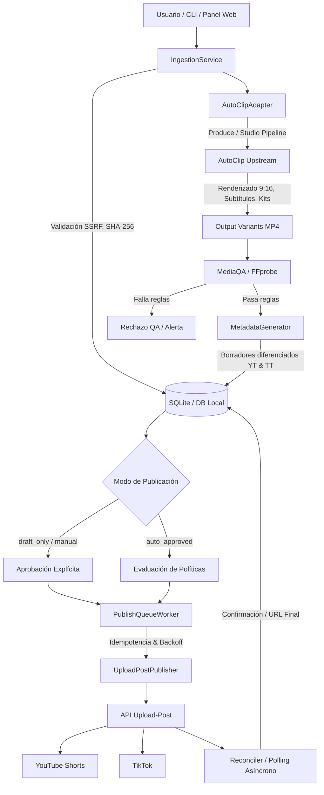

# Arquitectura de ClipFlow (autoclip-publisher)

## 1. Visión General y Objetivos

`autoclip-publisher` (`clipflow`) es un sistema de orquestación, validación y publicación automatizada diseñado para transformar videos de formato largo en clips verticales optimizados (9:16) para **YouTube Shorts** y **TikTok**, utilizando el motor nativo de [AutoClip](https://github.com/zhouxiaoka/autoclip) sin reescribir su algoritmo ni sus librerías de renderizado.

El sistema implementa la secuencia completa:
```text
Ingesta → Transcripción/Análisis → Selección → Renderizado 9:16 → QA Multimedia → Aprobación → Cola Durable → Upload-Post → Reconciliación Remota → Reportes
```

---

## 2. Diagrama de Flujo y Componentes



---

## 3. Capas del Sistema

### 3.1 Capa de Ingesta (`clipflow.ingestion`)
- Acepta archivos de video locales (`.mp4`, `.mov`, `.mkv`, `.webm`, `.avi`).
- Acepta URLs remotas compatibles de YouTube y Bilibili.
- **Protección Anti-SSRF:** Bloquea esquemas que no sean HTTPS, verifica dominios permitidos y realiza resolución DNS para bloquear IPs privadas, locales o de metadatos cloud (`127.0.0.1`, `10.0.0.0/8`, `192.168.0.0/16`, `169.254.169.254`).
- Calcula huella criptográfica SHA-256 de los archivos fuente.

### 3.2 Capa de Motor de Edición y Puente Upstream (`clipflow.autoclip_adapter`)
- Invoca directamente `backend.services.quick_output_runner` en Python o la CLI de AutoClip.
- Reutiliza el pipeline de Studio (`output_variants`, `jobs`, `publish-kits`).
- **Puente Inmutable:** Extrae el `output_variant_id` y su `video_path` final sin volver a re-exportar ni recodificar innecesariamente el video.

### 3.3 Capa de QA Multimedia (`clipflow.media_qa`)
- Emplea `ffprobe` para inspección técnica exhaustiva:
  - Existencia y peso (>0 bytes).
  - Duración finita (>0) dentro de rangos configurables (15s–180s).
  - Presencia de streams de video y audio.
  - Verificación estricta de relación de aspecto vertical 9:16 (1080x1920, ratio ~0.5625).
  - Verificación de codecs estándar (`h264`, `hevc`, `aac`).
- Genera un reporte tipado `QAReport` persistido en formato JSON (`qa.json`).

### 3.4 Capa de Metadatos y Borradores (`clipflow.metadata`)
- Genera títulos, descripciones y hashtags específicos por plataforma:
  - **YouTube Shorts:** Título limitado a 100 caracteres, descripción estructurada con `#Shorts`, eliminación de caracteres ideográficos CJK en audiencias occidentales.
  - **TikTok:** Título y descripción compactos con hashtags clave (`#fyp`, `#parati`, `#viral`).

### 3.5 Capa de Publicación y Reconciliación (`clipflow.publishing`)
- Implementa `UploadPostPublisher` integrando la API de Upload-Post.
- Respeta la privacidad por defecto:
  - YouTube: `private` (o `unlisted`).
  - TikTok: `SELF_ONLY`.
- Nunca declara un contenido como `PUBLISHED` solo por recibir HTTP 200 de aceptación inicial; requiere sondeo y confirmación remota.
- Si TikTok responde con borrador o bandeja de entrada (`fallback_to_inbox`), se cataloga como `ACTION_REQUIRED`.
- Reconciliador periódico que consulta `request_id` remotos y actualiza enlaces definitivos.

### 3.6 Capa de Cola y Persistencia (`clipflow.queue`, `clipflow.db`)
- Base de datos SQLite gestionada con SQLAlchemy (`models.py`).
- Bloqueo y despacho atómico de trabajos con clave de idempotencia única `(render_id, platform, account, schedule)`.
- Reintentos exponenciales con jitter para errores recuperables (HTTP 429, timeouts, 5xx).
- Parada limpia (*graceful shutdown*) capturando interrupciones de sistema.

### 3.7 Capa de Interfaz y Panel de Control (`clipflow.cli`, `clipflow.web`)
- Interfaz de comandos completa (`clipflow doctor`, `create`, `list`, `clips`, `approve`, `publish`, `schedule`, `status`, `worker`, `web`).
- Panel web administrativo moderno desarrollado en FastAPI + Jinja2 + Tailwind CSS con vista de proyectos, reproductor de video, inspección de QA y control de publicación.
